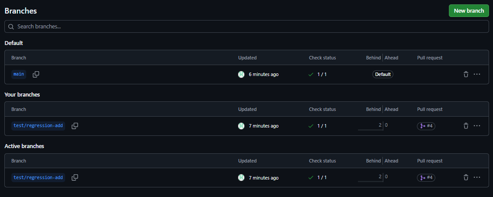
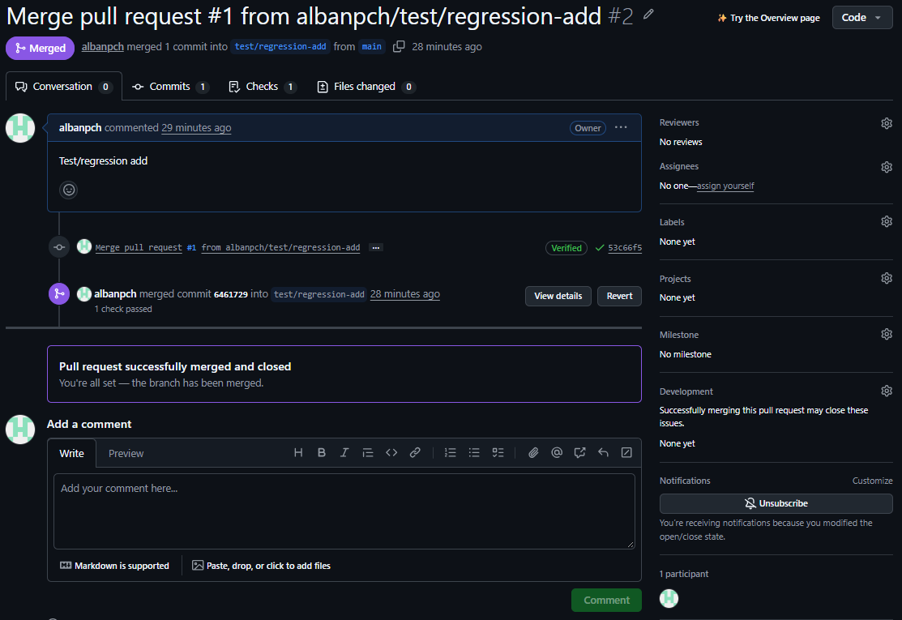
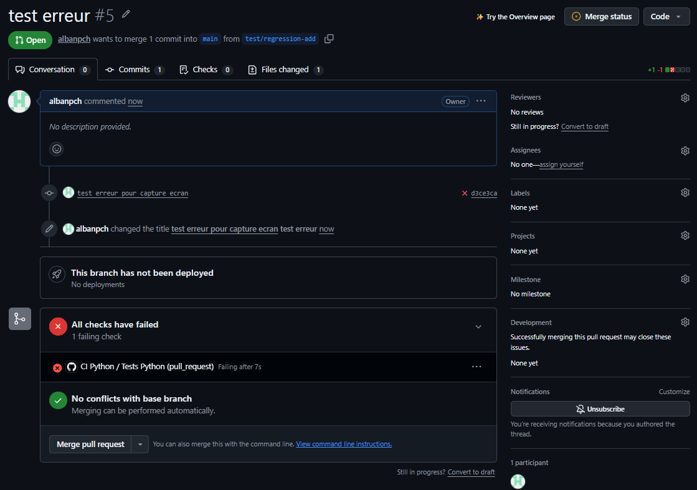

## 8. Bilan et compte rendu
## 8. Bilan et compte rendu

- **Nom du dépôt GitHub et URL :**
  - **Nom :** `TP_GitHub-Projects_CI-CD`
  - **URL :** https://github.com/albanpch/TP_GitHub-Projects_CI-CD

- **Nom de la branche principale utilisée :** `main` (branche secondaire utilisée pour la Pull Request : `test/regression-add`)

- **Capture d'écran du dépôt GitHub contenant l'arborescence du projet:**

- **Capture et lien vers votre pull request:**
  - **Lien :** https://github.com/albanpch/TP_GitHub-Projects_CI-CD/pull/2

- **Analyse de la régression et correction :**
  - **Nom du test en échec :** `test_add` (dans `tests/test_calculator.py`)
  - **Cause de la régression :** Une modification volontaire dans la fonction `add` du fichier `app/calculator.py` faussait le résultat de l'addition, entraînant un échec de l'assertion dans `pytest`.
  - **Correction effectuée :** Rétablissement de l'opération correcte (`return a + b`) dans `app/calculator.py`, suivi d'un commit et d'un push sur la branche `test/regression-add`.

- **Différence entre un test exécuté localement et une CI exécutée par GitHub :**
  Un test exécuté localement dépend de l'environnement et de l'action manuelle du développeur sur sa machine, tandis que la CI GitHub Actions s'exécute automatiquement dans un environnement propre et isolé sur les serveurs de GitHub à chaque `push` ou `pull_request` pour garantir la validité du code avant sa fusion.

**Conclusion :** Git conserve l'historique des changements ; GitHub héberge le dépôt et facilite le travail par pull request ; pytest exécute les tests ; GitHub Actions automatise leur exécution.